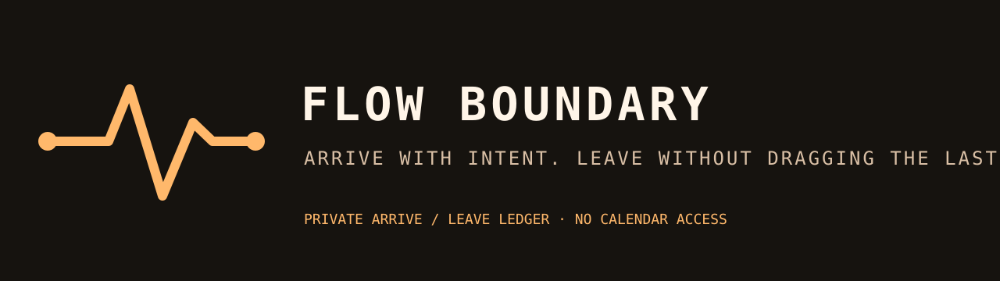

# Flow Boundary

<!-- intent-select-partner:start -->
<p><a href="https://intentsolutions.io/"></a></p>

Intent Solutions is a Claude Partner Network Select Services Partner.
<!-- intent-select-partner:end -->



[](https://ko-fi.com/U5S225PTME)

Flow Boundary marks the moment you enter or leave a focus block without handing
your schedule, projects, or notifications to another service. Its Omarchy bar
widget gives you explicit Arrive and Leave actions and a color-coded timeline of
recent context changes, helping you close one task cleanly before opening the
next and reconstruct where the day changed direction.

It does not inspect calendar events, project contents, or notification history.
The bounded history is stored through Omarchy's own inline widget-settings API,
so Flow Boundary opens no state pathname and needs no helper interpreter. There
is no account, cloud sync, telemetry, or background network access.

## Install

```bash
omarchy plugin add https://github.com/jeremylongshore/omarchy-flow-boundary-entry --enable
```

Use the panel's Arrive and Leave actions to create a local boundary record.

## Keys

Click Arrive or Leave, or use the keyboard: Left and Right (or `h` and `l`)
choose a button, Enter or Space marks it, and Escape closes the panel. The
highlighted button is the one Enter marks. Text and edges follow the lightness
of your theme's popup surface, so they stay readable on light themes.

## Where the history is stored

Boundaries are kept in `~/.config/omarchy/shell.json`, in the `eventsJson`
setting of this widget's entry in the bar layout. Each record is the word
`arrive` or `leave` and a Unix timestamp, and only the latest 32 are kept. If
you keep `shell.json` in a dotfiles repository, those timestamps are part of
what you would commit.

## Preview

`preview.png` is a rig render, not a user screenshot. The rig seeds three
boundaries (arrive, leave, arrive) into the widget setting, records one more
through the plugin's own IPC `leave` call, and restarts the shell before the
capture. A fresh install starts with an empty timeline.

## Verify

```bash
npm test
bash scripts/run-plugin-gates.sh
bash scripts/check-lane-freshness.sh
bash scripts/rig-verify.sh .
bash scripts/rig-render.sh . preview.png
# Optional: render on a light theme
OMARCHY_RIG_THEME=catppuccin-latte bash scripts/rig-render.sh . /tmp/light.png
```

## Maintainers wanted

These plugins are growing, and we are looking for dependable Omarchy users who
want to review issues, test releases, and keep a plugin healthy over time. Start
with a small pull request or [open a maintainer interest issue](https://github.com/jeremylongshore/omarchy-flow-boundary-entry/issues/new?template=maintainer_interest.md&title=Maintainer%20interest%3A%20)
titled **Maintainer interest**. Tell us which plugin you use and how you want to
help. Consistent contributors can earn maintainer responsibility.

## License

MIT
